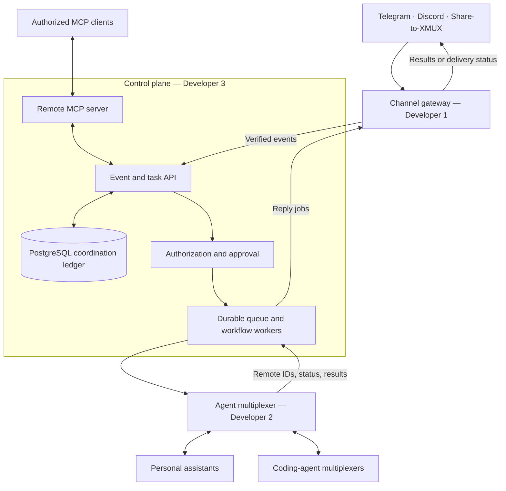
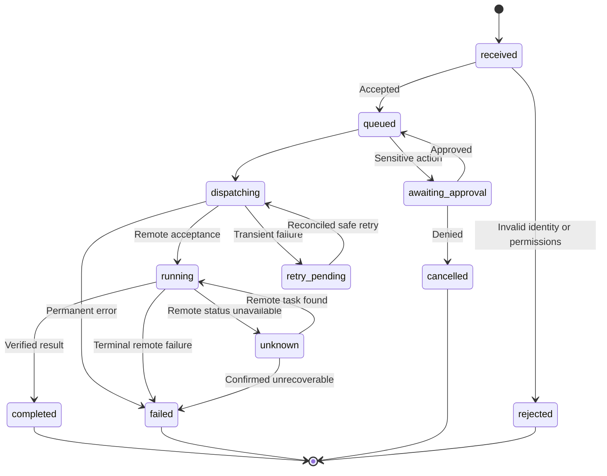

<div align="center">

# XMUX

### Universal Personal Agent Gateway

**Capture where you are. Delegate to the right agent. Follow the work anywhere.**

Messages, mentions, shares, and MCP calls → coordinated work across your existing assistants.

[Architecture](#architecture) · [MVP](#mvp-scope) · [Ownership](#developer-ownership) · [Roadmap](#roadmap)

</div>

---

> **Status: architecture specification / MVP planning.** This repository currently contains project documentation. The services and integrations below are planned capabilities.

## What is XMUX?

XMUX connects the apps where you discover information to the assistants that can act on it. Capture an authorized message, post, or URL; delegate a structured task; track its progress; and receive the result through a supported channel or MCP client.

XMUX owns intake, coordination, approvals, and delivery. Destination assistants retain their own memory, schedules, execution environments, and artifacts. The coordination ledger stores task state and remote references, with limited content retention governed by policy.

### The north-star demo

1. **Capture** — Share a technical post with the Telegram bot.
2. **Research** — Ask Hermes to evaluate it through a supported interface.
3. **Approve** — Review a checkpoint before repository modifications.
4. **Build** — Send the approved prototype to an existing coding multiplexer.
5. **Track** — Check status and artifact links from Claude or another compatible, authorized MCP client.

## Architecture



**Verified events → durable coordination → capable agents → traceable results.**

Every adapter declares its actual capabilities. Platform access, agent interfaces, and MCP client support must be verified before enabling an integration.

## MVP scope

| Area         | Initial target                                                                                        |
| ------------ | ----------------------------------------------------------------------------------------------------- |
| Channels     | Telegram and Discord capture and replies using supported bot APIs                                     |
| Agents       | One personal assistant and one existing coding multiplexer                                            |
| Coordination | Persistent tasks, durable workers, reconciliation, approvals, workflow dependencies                   |
| MCP          | Authorized capture, delegation, discovery, status, approval, reference search, and supported routines |
| Operations   | Docker Compose on a VPS, PostgreSQL, Redis, CI, health checks, metrics, runbook, backups              |

Supported actions will include summarizing, researching, delegating instructions, saving references where supported, coordinating dependent tasks, and checking results. Routine creation requires an assistant that confirms scheduling support and returns a remote schedule ID.

Slack and GitHub are follow-on integrations. WhatsApp Business, Instagram professional accounts, Reddit, X, and LinkedIn require platform-specific feasibility and permission checks. Explicit browser sharing is a planned fallback for restricted platforms.

## Reliability and trust

- **Verified identity:** map platform identities to trusted principals; require explicit linking for cross-platform privileges.
- **Authorized content:** inaccessible sources return `content_unavailable` or a request for supplied text. Captured content cannot grant execution permissions.
- **Capability-aware routing:** honor explicit agent selection subject to capabilities, authorization, and availability. Return explicit errors for unsupported operations.
- **Durable tasks:** survive restarts and deduplicate repeated events using idempotency keys.
- **Safe recovery:** reconcile uncertain dispatches using remote task or correlation IDs before retrying a non-idempotent action.
- **Approval checkpoints:** sensitive actions, including repository changes and outbound posts, wait for authorized approval according to policy.
- **Minimal retention:** retain coordination metadata and remote references; redact secrets and private message content from logs.
- **Service isolation:** authenticate internal endpoints and keep them off public ingress. Remote MCP tools require authentication and authorization.

### Task lifecycle



## Developer ownership

All three developers agree on `packages/contracts` before independent implementation. Cross-team changes require a contract PR and contract tests. Each developer owns their service logic and mocks.

| Owner                           | Modules                                                                           | Responsibilities                                                                                  |
| ------------------------------- | --------------------------------------------------------------------------------- | ------------------------------------------------------------------------------------------------- |
| **Developer 1 — Gateway**       | `apps/gateway`, `packages/channel-adapters`, `packages/content-extractors`        | Bot integrations, verification, sender mapping, authorized extraction, normalized events, replies |
| **Developer 2 — Multiplexer**   | `apps/multiplexer`, `packages/agent-adapters`, `packages/routing-engine`          | Registry, capabilities, health, routing, dispatch, remote status/results, federated references    |
| **Developer 3 — Control plane** | `apps/orchestrator`, `apps/mcp-server`, `packages/workflow-sdk`, `infrastructure` | Database, APIs, state machine, queue, reconciliation, approvals, workflows, MCP, operations       |

### Planned repository structure

```text
xmux/
├── apps/
│   ├── gateway/               # Developer 1
│   ├── multiplexer/           # Developer 2
│   ├── orchestrator/          # Developer 3
│   └── mcp-server/            # Developer 3
├── packages/
│   ├── contracts/             # Shared
│   ├── channel-adapters/      # Developer 1
│   ├── content-extractors/    # Developer 1
│   ├── agent-adapters/        # Developer 2
│   ├── routing-engine/        # Developer 2
│   └── workflow-sdk/          # Developer 3
├── infrastructure/            # Developer 3
├── tests/
│   ├── contracts/
│   ├── integration/
│   └── end-to-end/
└── docs/
```

## Planned interfaces

| Endpoint                           | Purpose                                | Owner       |
| ---------------------------------- | -------------------------------------- | ----------- |
| `POST /v1/events`                  | Ingest verified normalized events      | Developer 3 |
| `POST /v1/tasks`                   | Create an idempotent coordination task | Developer 3 |
| `GET /v1/tasks/{id}`               | Read authorized task status            | Developer 3 |
| `GET /v1/tasks/{id}/result`        | Read results or remote references      | Developer 3 |
| `POST /v1/tasks/{id}/approve`      | Record authorized approval             | Developer 3 |
| `GET /v1/agents`                   | Discover agents and capabilities       | Developer 2 |
| `POST /internal/agents/dispatch`   | Delegate work                          | Developer 2 |
| `GET /internal/agents/{id}/health` | Check agent availability               | Developer 2 |
| `POST /internal/delivery`          | Submit an outbound reply job           | Developer 1 |
| `/mcp`                             | Expose authorized remote MCP tools     | Developer 3 |

Planned MCP tools: `capture_content`, `delegate_task`, `get_task_status`, `list_agents`, `approve_action`, `create_routine`, and `search_references`. Routine creation must verify destination support and track the remote schedule reference.

## Roadmap

The four-week schedule is a planning target. Platform approvals and external interfaces may affect delivery.

| Milestone                    | Focus                                                                 | Exit condition                                         |
| ---------------------------- | --------------------------------------------------------------------- | ------------------------------------------------------ |
| **Week 1 — Foundation**      | Contracts, monorepo, database, task API, Telegram, mock agent         | Telegram → verified event → durable mock task → reply  |
| **Week 2 — Real delegation** | Discord, extraction, agent adapters, routing, workers, reconciliation | Real agent task → result → channel reply               |
| **Week 3 — Coordination**    | MCP, identity linking, fallback, approval, dependent workflows        | Authorized MCP delegation and approval-gated workflows |
| **Week 4 — Hardening**       | Delegated routines, reliability, CI, Docker, monitoring, runbook      | North-star demo and acceptance checks pass             |

### MVP acceptance checklist

- [ ] Duplicate Telegram webhook delivery creates exactly one task.
- [ ] Discord commands create tasks and reply in the correct context.
- [ ] Invalid signatures and unauthorized users are rejected.
- [ ] Extraction records provenance and reports inaccessible content explicitly.
- [ ] Explicit agent choice takes precedence over automatic routing.
- [ ] Capability mismatch returns `unsupported_capability`.
- [ ] Hermes returns a verifiable result through a supported interface.
- [ ] A coding multiplexer returns status and artifact references.
- [ ] Tasks remain queryable after restart.
- [ ] Dispatch timeouts are reconciled before retrying.
- [ ] Sensitive workflow steps wait for authorized approval.
- [ ] An authorized MCP client can list agents, delegate, and check status.
- [ ] Routine creation requires confirmed support and a remote schedule ID.
- [ ] Results reach the originating channel or record explicit delivery failure.
- [ ] Logs and responses expose neither secrets nor another user's task data.

## Development workflow

Use a feature branch for every change, including documentation. Keep changes within module ownership and review shared contracts before dependent implementation.

```bash
git switch main
git pull --ff-only origin main
git switch -c feat/short-description
```

The backend framework, package tooling, exact agent interfaces, retention window, and detailed approval policy remain open decisions. Installation and startup instructions will be added with the working scaffold.

## Boundaries and expansion

Integrations use supported APIs, CLIs, or webhooks. The MVP does not assume unrestricted social-platform access or automate unsupported assistant chat interfaces. Each adapter must publish supported triggers, reply methods, content access, permissions, rate limits, retention restrictions, and unsupported operations.

Later phases may add more channels, workflow templates, a dashboard, granular permissions, multi-tenant support, and cost-aware routing after validating the core capture-to-result loop.
